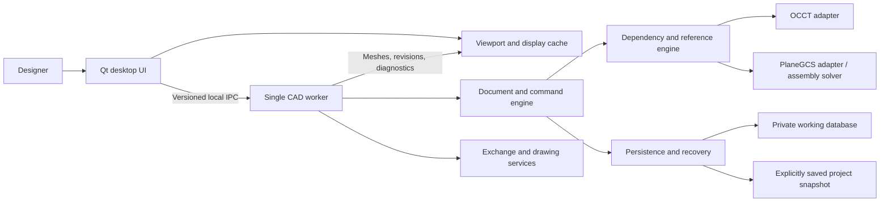
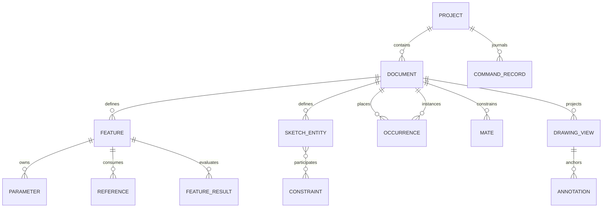
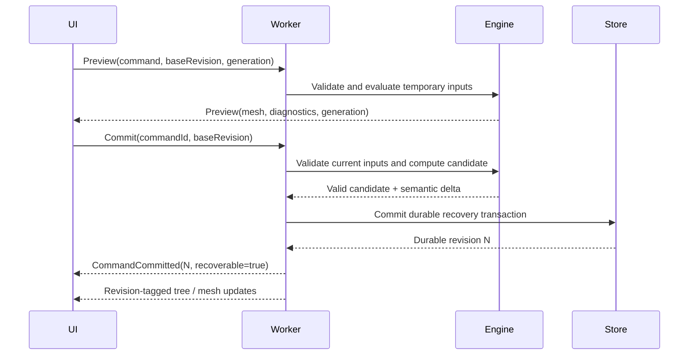

# Software Design Description — Solidworks Clone

**Version:** 0.1 · **Date:** 19 October 2026  
**Status:** Proposed design; feasibility decisions are gated by [Step Zero](STEP_ZERO.md).  
**Requirements authority:** [SRS](SRS.md). **Contracts and sequence:** [TECH_SPEC](TECH_SPEC.md).

## 1. Design goals and boundaries

Deliver a precise native CAD workflow on an 8 GB system, preserve design intent and recoverable work, and maintain a familiar dense desktop interface. Reuse mature geometry and constraint components while implementing our own document semantics, UI, feature evaluation, and recovery policy.

The initial architecture has two processes: a Qt desktop application and one local CAD worker. It is not a server deployment. No browser engine, required HTTP service, container, account service, or cloud database belongs in the core runtime. This is a design choice for this product, not a claim that those technologies can never build CAD software.

The kernel is replaceable at an adapter boundary, but kernel replacement would still require geometry, topology, tolerance, migration, and interoperability work. An interface does not make two CAD kernels interchangeable without effort.

## 2. Context and component ownership

| Component | Owns | Must not own/do |
|---|---|---|
| Desktop shell | Windows, docks, focus, accessibility, command forms, preferences | Authoritative feature mutation or direct project SQL writes |
| UI document projection | Revisioned summaries, tree rows, selected IDs, job statuses | Raw native pointers or mutable kernel objects |
| Viewport adapter | GPU resources, meshes, pick buffers, visual overlays | Exact BRep as an independent authoritative copy |
| Worker host | IPC session, queue, document lifetimes, cancellation, process diagnostics | Unbounded worker/process spawning |
| Document engine | Stable IDs, semantic state, command validation, transaction sequencing | Widget dependencies or arbitrary script evaluation |
| Evaluation engine | Dependency order, affected-result invalidation, evaluation results | Silent reuse of results from a different revision/engine version |
| Sketch/assembly adapters | Numerical state, degrees of freedom, conflict diagnostics | Treating a solver return code alone as geometric validity |
| OCCT adapter | Exact geometry creation, validation, history maps, tessellation requests | Deciding product history, save status, or user repair policy |
| Persistence service | Working DB, snapshots, migrations, recovery selection | Advertising success before required persistence completes |
| Exchange/drawing services | Translators, view projection/hidden lines, annotations, PDF output | Inventing native SolidWorks feature history |

One worker can hold multiple documents and shared component definitions. Authoritative mutations are serialized. Background computation may use bounded parallel tasks on independent data only where the pinned libraries are verified safe. Graphics resources remain on their platform-required thread. No thread is permitted to mutate the same kernel shape concurrently.

## 3. Core domain model

### 3.1 Definitions, identities, and units

Use opaque UUID identifiers for projects, documents, features, sketch entities, constraints, occurrences, mates, views, and annotations. Names are editable labels, never identity. A monotonically increasing document revision records semantic commits; a separate worker-session epoch prevents old-process messages being accepted after restart.

Qualify all cross-project handles/cache keys with project ID and document ID. Save As may preserve entity IDs inside a new project identity; opening the original and copy together must not alias their editable state. Shared component-definition keys also include the source identity/revision or validated content fingerprint.

Store semantic lengths in SI meters, angles in radians, and mass in kilograms. UI values carry explicit display units. The OCCT adapter converts to its declared working-length convention, initially millimeters, at a single tested boundary. Tolerances are physical quantities, not unlabelled constants. Do not pass unitless UI numbers to kernel APIs.

### 3.2 Entity relationships

| Domain object | Essential fields |
|---|---|
| Project | ID, schema version, engine/solver manifest, document index, save generation |
| Document | ID, type, name, revision, units, source/dependency records |
| Feature | ID, type + definition version, ordered label, typed parameters, input references, suppression state |
| Sketch | Support plane/reference, local coordinate frame, entities, constraints, accepted solve state |
| Feature result | Feature ID, evaluated revision/fingerprint, output shape IDs, validity, diagnostics, optional cache key |
| Reference | Owner, source feature/occurrence context, semantic role, persistent subshape token, resolution state |
| Occurrence | ID, referenced definition/document revision policy, rigid transform, display/load state |
| Mate | IDs of occurrence-scoped references, type, alignment, typed value, solver status |
| Drawing view | Source document + revision, projection transform, scale, hidden-line policy, stale state |
| Annotation | Type, source reference or explicit sheet anchor, placement, display format, dangling state |
| Command record | Operation ID, actor/session, base/new revision, versioned intent, inverse or undo reference, timestamp |

R1 assemblies are rigid. A component definition is shared; an occurrence owns placement and occurrence-scoped metadata. Hidden means not drawn, suppressed means excluded from relevant evaluation, unloaded means exact data is absent, unresolved means a required dependency cannot be located, and stale means the displayed result is older than its semantic inputs. These are separate state dimensions rather than one ambiguous “inactive” flag.

## 4. Command and job lifecycle

### 4.1 Preview and commit

Previews are disposable. Accept requests are revalidated against the current document revision, selected references, and current engine epoch. A stale preview cannot become an authoritative edit just because its image is still visible. Reuse preview computation only if the complete evaluation fingerprint matches the commit request.

The database transaction includes the semantic delta, authoritative imported data needed for regeneration, revision, and command record. A failure leaves the previous committed model authoritative. If a candidate cannot be durably recorded, show a persistence failure and keep it as an uncommitted preview where possible; do not report it as recoverable.

After durable commit, failure to install a derived in-memory result must trigger reconstruction from that revision or worker restart. It must not roll the durable revision backward silently. UI acknowledgments distinguish receipt, computation, and durable commit.

### 4.2 Queue and cancellation

States: `Queued → Running → Succeeded | Failed | Canceled`; a queued job can cancel directly. A running job can enter `CancelRequested` until a safe boundary is reached. Commit publication is serialized against cancellation; the result must be either committed once or canceled without publication.

Preview requests are coalesced by command session, retaining the newest generation. Explicit accepted commands are never silently coalesced. Cancellation checks occur between features, solver iterations where supported, meshing stages, and translation stages. An uninterruptible native call may need worker termination after the user requests it. The UI explains that the worker is being restarted and recovers the last durable revision.

The worker process is a reliability boundary, not an operating-system security sandbox. Import validators and resource limits remain required.

## 5. Local IPC and display transport

Use Qt local sockets for control messages; no TCP listener is required. The worker endpoint is created in a private per-user application directory with platform-appropriate access restrictions and a session capability passed through inherited process communication, not an ordinary log or command line.

Every request carries protocol version, request/command ID, worker epoch, document ID, base revision, command session, generation, and a typed payload. Replies echo correlation fields and include result revision, status, and structured diagnostics. Both sides bound message size, collection count, string size, allocation requests, and decompressed data. Reject unknown mandatory protocol fields/versions safely.

Small control data uses explicitly versioned CBOR envelopes. Large meshes use bounded shared-memory buffers or chunked fallback transfer. A mesh manifest describes buffer sizes, offsets, index types, bounds, source revision, entity/occurrence IDs, and checksums. Validate all offsets before mapping or uploading. Buffer ownership is acknowledged and reference-counted; release orphan segments after a worker crash.

The UI discards old epochs, mismatched document sessions, superseded preview generations, and out-of-order revisions. A command whose acknowledgment is lost has an uncertain outcome; query its operation ID/revision on reconnect. Do not blindly replay it and create duplicate geometry.

Initial OCCT display integration uses mesh/custom interactive presentations, not `AIS_Shape` objects requiring a second full BRep in the UI. Step Zero must prove picking, highlighting, overlays, and precision-query routing with this ownership model. If it fails, record a revised ownership design and profile its memory before proceeding.

## 6. Parametric evaluation and reference tracking

### 6.1 Dependencies and invalidation

Represent explicit feature, expression, support-plane, source-body, assembly, and drawing dependencies. A command computes the impacted subgraph. Topologically sort it and reject cycles before publication. Include feature definition version, typed parameters, resolved upstream result keys, tolerance policy, kernel version, and relevant options in evaluation fingerprints.

Preserve the latest valid result when an evaluation fails, but mark it stale. Downstream results may remain visible as stale references; measurement, export, and drawing publication must either use an explicit last-valid revision with a warning or require successful evaluation. Never silently export an old model as current.

Unrelated branches may reuse validated cached results. Sharing cached immutable results does not imply every operation can run in parallel. Memory admission and kernel thread-safety determine actual concurrency.

### 6.2 Topological references

Array indices such as “face 7” are not persistent identity. Track feature provenance, kernel generated/modified/deleted history, semantic roles, and context. Reference resolution proceeds through:

1. Direct semantic identity where the defining entity still exists.
2. Verified kernel history mapping for the supported operation.
3. Constrained geometric matching using surface/curve type, adjacency, location, orientation, and dimensions.
4. Explicit unresolved/ambiguous status if multiple or no candidates remain.

Record split/merge relations rather than pretending every topology change is one-to-one. A geometric score is evidence for a candidate, not permission to reattach an engineering dimension arbitrarily. The repair UI previews the old role, candidate, and affected downstream features, then commits a replacement as an undoable command.

Drawing annotations and mates consume this same reference service with occurrence/view context. Topological naming is a continuing correctness risk; acceptance fixtures include ambiguous symmetric faces, splits, deleted faces, and pattern changes.

## 7. Sketch and assembly solving

The implemented Module 3 adapter, supported combinations, semantic collection
format, tolerance/diagnostic policy and limits are recorded in
[the sketch ADR](decisions/module-3-sketches.md), with actual results in
[Module 3 evidence](testing/module-3.md). Those scoped results do not close the
platform, installed-build or full workload acceptance gates.

The sketch adapter maps our stable entity/constraint IDs to PlaneGCS-owned numerical variables. It controls variable lifetime, scale normalization, convergence settings, and diagnostic translation. Persist semantic entities and accepted values, not raw solver memory. Unsupported constraint/entity combinations must be unavailable with a reason.

Validate residuals, finite values, radii, degeneracy, and intended constraint satisfaction after solve. Degrees of freedom and redundant/conflicting sets should be recomputed when needed; a raw equation count is insufficient. Dragging uses temporary objectives and a previous accepted solution to reduce branch flips. Cancel restores the pre-drag state.

The assembly solver represents each movable rigid occurrence with translation and rotation variables, fixing the global gauge with grounded occurrences. Support analytic planar/axial mate residuals first. Use an adapter over a small tested numerical implementation, initially Eigen-based; choose the actual algorithm and parameterization from Step Zero evidence. Unit scale, angular wrap, quaternion normalization if used, rank deficiency, and conflicting cycles need explicit tests.

PlaneGCS integration success is not acceptance of the assembly solver. If initial mate feasibility fails, redesign or explicitly revise R1; do not ship decorative mate controls.

## 8. Geometry and numerical validity

OCCT is the initial exact BRep kernel. Construct bodies using supported operations and validate the outputs, orientation, closure, tolerance growth, and expected solid count. Distinguish geometric invalidity from unsupported input and numerical failure. Preserve detailed engine diagnostics for local troubleshooting and translate them into useful user messages.

Display tessellation is derived data. Changing tessellation quality cannot alter feature parameters or precise exports. Kernel tolerances use a declared unit-aware policy, with scale checks and documented import overrides. Never automatically enlarge tolerances until an operation “works” without showing the resulting geometry change.

Pattern/mirror instances may share representation while preserving occurrence or feature identity. Boolean fusion can still require separate exact computation; graphics instancing alone does not implement a fused parametric feature.

## 9. Persistence, save, recovery, and migration

### 9.1 Storage layout

Use a single SQLite-based `.cadproj` file for a portable saved project. This extension is provisional. The file contains semantic documents, references, versioned feature definitions, authoritative imported geometry blobs, required metadata, and a manifest. Optional evaluated BRep/mesh caches are version-keyed and discardable. Persistent imported source data must not be treated as a disposable cache when it is the only regeneration input.

During editing, the worker uses a private working database under application recovery storage, created from the saved project. Its recovery journal, current semantic state, and revision are committed together. Saved projects are snapshots, not the live working WAL database. Thus a user explicitly saved revision and a newer recoverable revision can coexist without silently overwriting the saved file.

SQLite owns atomicity inside one database; it does not make an external blob directory atomic. R1 therefore stores required payloads inside the project/working DB. Large blobs are streamed through staging and incremental I/O with caps. Optional external references are explicit links that portable-copy tooling resolves or reports missing.

### 9.2 Explicit save protocol

1. Pin a consistent committed revision for the entire snapshot operation, then create a sibling temporary snapshot using SQLite's supported snapshot/backup mechanisms. Prove the selected implementation uses a stable source read view, or temporarily serialize mutations while copying; do not assume a multi-step copy preserves the requested revision while writes continue. Bound retained WAL growth during a long snapshot.
2. Validate schema, required object references, manifest, and snapshot integrity; close/checkpoint it into a standalone file.
3. Flush the file, replace the destination with platform-appropriate atomic replacement where supported, and flush directory/metadata as required by the platform durability policy.
4. Report `Saved revision N` only after publication succeeds. Track the saved revision separately from any newer edits.
5. Retain the previous good snapshot or backup according to policy; clean abandoned temporary files only when they cannot be the sole valid copy.

A copied live database without its WAL is not a valid save method. If the crash occurs after publication but before the UI receives acknowledgment, compare destination project ID/revision and operation records on recovery. Current revision N+1 remains modified if only N was saved.

### 9.3 Recovery and ownership

Lock a project writer by canonical identity with an OS-supported lock; path spelling alone cannot prevent aliases/symlink duplicates. Recovery databases have separate locks and an original-project identity. Stale lock cleanup requires proving the owner is absent or obtaining the OS lock, not trusting an old PID alone.

On restart, offer last explicitly saved and newer verified recoverable versions with timestamps/revisions. Do not overwrite either before the user selects recovery. A successful durable command acknowledgment guarantees recovery under the documented local-filesystem assumptions; an unacknowledged operation is queried, not assumed missing. Power-loss durability remains subject to filesystem/storage behavior, as [SQLite documents](https://sqlite.org/atomiccommit.html).

Undo uses semantic deltas/inverses and checkpoint references under bounded retention. An undo/redo action itself is a new durable command/revision. It must not resurrect a blob already garbage-collected. Retention roots include saved revisions, recovery, undo/redo, active jobs, open documents, and pending exports. Garbage collection runs only after those roots are considered.

### 9.4 Migration and schema ownership

One persistence service owns schema changes. Check the application/schema/feature/engine compatibility manifest before opening for write. Migrate a verified copy and publish it only after validation. Unsupported future schemas are rejected without mutation. Geometry caches may rebuild after engine changes; authoritative imported geometry requires a tested reader/conversion path. Never call an unreadable authoritative BRep a cache and delete it.

## 10. UI and interaction architecture

Use `QMainWindow`, dock widgets, actions, model/view trees, and reusable property-editor components. Keep document type, active edit context, selection, command session, preview generation, and job state explicit. The same command definitions drive menus, search, contextual toolbars, and shortcuts.

| Region | Role | Behavior |
|---|---|---|
| Top command area | Global actions + task tabs | Contextual availability with reasons; persistent search |
| Left manager | Feature/component tree or active command parameters | Preserve tree expansion/scroll and return focus after command completion |
| Central viewport | Geometry, previews, dimensions, direct manipulation | Revision-aware selection; clear committed vs preview appearance |
| Right task pane | Libraries/materials/view resources | Optional, lazy-loaded, collapsible |
| Bottom | Documents, edit mode, units, save/rebuild/job status | Text labels and icons; color is supplementary |

Implementation staging: [TECH_SPEC 4.0](TECH_SPEC.md#40--align-the-native-modeling-workspace-before-adding-solid-tools) owns the early SolidWorks-style Features/Sketch/Evaluate command tabs, left PropertyManager/tree switch, and overall modeling layout, before exact feature UI is added. Module 9 completes consistency, familiar/simplified modes and accessibility across document types. Module 3 input repair adds stable model-space camera/anchors, optional grid, screen-distance point snapping, native gesture paths, direct shape properties/handles and bounded draft undo. Module 4.0 implements the command tabs and left PropertyManager in the available-Mac development build; [workspace evidence](testing/module-4.md) records verification and missing platform/device checks. No complete SolidWorks parity or full requirement acceptance is claimed. The subsequent explicit Module 4 authorization covers exact features; [part adapter decisions](decisions/module-4-features.md) record schemas, ownership, storage, provenance and supported cases. Stop before Module 5.

Property panels share title/help, accept/cancel, selection roles, collapsible sections, unit-aware values, and preview feedback. Their actual inputs differ by command. Some measurement and dimension tools are nonmodal; do not make every tool a blocking dialog. Confirmation behavior, keyboard focus, and Escape semantics are specified in TECH_SPEC.

Familiar and simplified layouts expose the same engine operations and document format. Simplification hides advanced presentation, not precision or data. Icons/assets are original; atlas screenshots guide spatial/interaction decisions rather than serving as application artwork. Selection/tree/parameter updates are joined by stable IDs, not independent mutable copies.

Publicly undocumented panels need further reference inspection or an explicitly original design. Record any claimed difference as a product choice, not a proven fix to a current SolidWorks bug.

## 11. Graphics, drawings, and exchange

### 11.1 Viewport

Start with OCCT visualization using lightweight mesh presentations. Keep a renderer interface for camera, mesh upload, instance transforms, highlights, picking, clipping, and overlays. CPU mesh caches and GPU buffers have separate accounting. Evict stale revisions and release display resources on document closure.

Use adaptive tessellation, shared geometry, and frustum culling. Coarse previews improve navigation but do not establish exact measurements. Picking identifies candidate semantic entities; exact geometry queries and measurement run in the worker against the same revision. Bound outstanding hover/pick requests.

Apple deprecates OpenGL; current prototype support must be measured on supported Mac versions. A Metal-backed route is a feasibility decision, not an implemented OCCT setting. Revisit renderer choice before depending on undocumented/private Qt graphics APIs or assuming one backend works indefinitely.

### 11.2 Drawings

Generate projected geometry and hidden lines from exact model data. Drawing views store transforms, scale, and source revision. Annotation anchors resolve through the shared reference engine. Maintain drawing sheet coordinates separately from model coordinates. New model revisions mark views stale until recomputed; PDF export requires current views or an explicit last-valid export warning.

Use vector paths/text for PDF where possible and explicit raster fallback only for unsupported view content. Validate page dimensions, projection convention, measured scale, line weights, fonts, dimension values, and BOM counts. A viewport screenshot printed to a PDF does not satisfy associative engineering drawing requirements.

### 11.3 Exchange

Translate STEP/IGES through OCCT adapters; preserve supported units/names/colors and report loss. Imports become an imported-body feature with provenance and stored authoritative input. Healing is explicit and reports geometric changes. Run validation before accepting imported bodies.

STL is triangulated and has no universally authoritative embedded length unit; UI/export metadata must state the chosen convention. STEP round trips compare topology/geometry invariants within tolerance, not proprietary feature history or byte identity. Cancel/failed translation publishes neither a partial feature nor an incomplete destination file.

## 12. Resource governance

The SRS owns numerical budgets and B0–B6 fixtures. A process-family memory sampler records UI, worker, GPU/shared allocations where observable, and temp disk. Metrics differ across OSes; retain raw per-process figures plus the documented aggregate calculation instead of pretending RSS sums equal unique physical memory.

Use one default heavy geometry job, a bounded preview queue, a bounded display cache, and disk-backed older history. A second concurrent heavy task requires measured headroom. Before expensive work, estimate inputs/result/cache cost; estimates can be wrong, so also monitor pressure and cancel/trim where safe. A native allocator failure may kill the worker; recovery remains required.

Under pressure: stop speculative previews → evict obsolete display/derived caches → lower display detail → unload inactive exact component data → postpone heavy jobs with an explanation. Never delete authoritative project data or silently drop accepted features. “Unload” can release only data reconstructible from retained authoritative records.

## 13. Security, privacy, and diagnostics

Use schema/type validation and resource caps for project records, imported geometry, IPC buffers, and archive-like portable inputs if introduced later. Do not execute imported macros or expressions as code. The expression language is a parsed arithmetic grammar with dimension checking. Reject unbounded recursion, cycles, nonfinite values, and excessive AST sizes.

Logs use correlation IDs and redact model names/paths by default; diagnostic export is user initiated. No background model upload or mandatory telemetry. The worker has normal user filesystem access unless separately sandboxed; a process split alone does not prove malicious-file containment.

Development, test, and installed-release data roots are distinct. Synthetic fixtures cannot write production project/recovery directories. Signed packages and dependency manifests are release artifacts; credentials/signing identities are provided through platform tooling, never stored in source.

## 14. Architectural decisions and trade-offs

The design decisions below remain proposals for production. Module 0 pins, experiments, consequences and revisit triggers are recorded in the [feasibility ADR register](decisions/feasibility-adrs.md); they do not establish release acceptance.

| ID | Proposed decision | Alternatives and trade-off | Revisit trigger |
|---|---|---|---|
| ADR-01 | C++20 + Qt Widgets | Native platform-specific UIs multiply UI work; Qt Quick is attractive for fluid interfaces but adds a different scene/UI integration model. Widgets matches this dense first-release workspace. | Accessibility/rendering integration failure or measured footprint |
| ADR-02 | OCCT kernel | Commercial kernels/translators may improve particular operations or compatibility at a licensing/integration cost; writing a kernel is far larger scope. OCCT still requires feature/reference engineering. | Required operations fail robustness corpus |
| ADR-03 | PlaneGCS candidate for 2D | Custom solver increases numerical work; other solvers need separate API/license evaluation. Integration requires an adapter and pinned-source review. | Conflict/drag/scale tests fail |
| ADR-04 | UI + one local worker | One process reduces IPC complexity but shares native crash fate. More workers may improve throughput but increase peak memory and ownership complexity. | Measured interaction or crash-recovery failure |
| ADR-05 | Working SQLite + standalone project snapshots | Live editing the user file makes saved/recoverable distinction harder. External blob packs complicate atomic publication. Embedded blobs increase copy/save cost. | B2/B4 save/size budgets fail |
| ADR-06 | Renderer boundary, OCCT prototype first | A custom Metal/Vulkan renderer adds major picking/overlay work. OpenGL expedites validation but has Mac longevity risk. | Mac support or driver evidence |
| ADR-07 | Our semantic feature/reference layer | Reusing an entire existing CAD application's core can accelerate breadth but introduces its document/UI contracts and migration commitments. A new layer gives control at substantial development cost. | Spike results show core cost/robustness unacceptable |

## 15. Verification boundaries

Unit tests cover math, units, reference resolution, and serialization. Real-kernel tests cover shape validity and geometric invariants. Real temporary SQLite/filesystem tests cover persistence and process-kill recovery. Native UI tests cover selection, focus, workflows, accessibility, and installed integration. Visual review covers placement/scaling, not numerical correctness.

Cross-process tests inject stale replies, lost acknowledgments, malformed buffers, worker exit, and cancel/commit races. Dependency upgrades rerun geometry, reference, recovery, and resource corpora. See [traceability](TRACEABILITY.md) and each TECH_SPEC module for required evidence. Module 0 results are prototype evidence only; product acceptance remains Not run.
