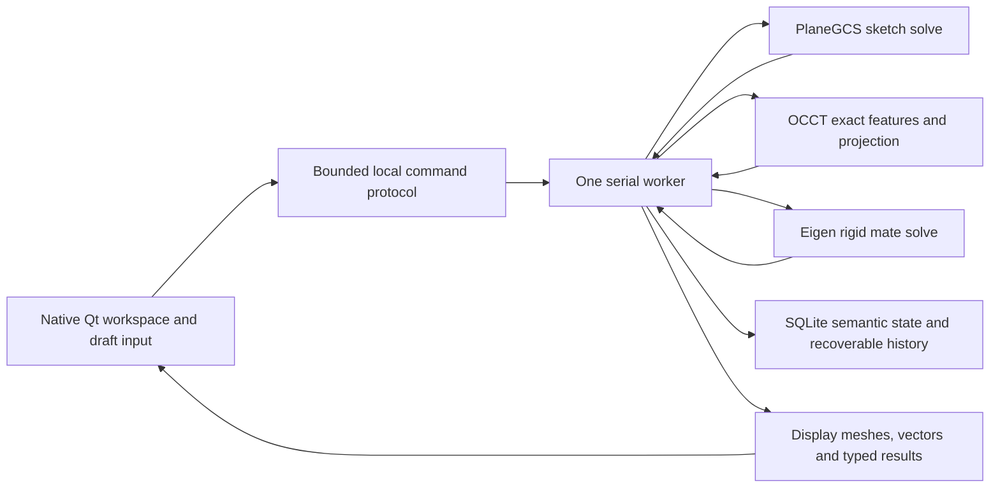

# SolidWorks faculty training compared with DatumForge

Reviewed: 22 October 2026. Scope: the 11 PDFs in
`/Users/binova/Downloads/T SHEETS FOR FACULTY ONLY`, current implementation,
and existing module evidence. This is a research comparison, not a feature
implementation or a new acceptance run. No production code, specification scope,
deferred gates, or Module 11 authorization changes.

## Main finding

DatumForge implements the same broad mechanical-CAD workflow taught by these
sheets: constrained planar sketches, exact solid features, editable history,
rigid assemblies, and model-derived drawings. Its implemented command set is
substantially narrower than the course. A familiar workspace and matching command
names do not make the exercises interchangeable.

The largest practical gaps are sketch editing/inferencing/dimensioning,
associative reference planes and face-attached sketches, richer feature options,
shell/sweep/loft, assembly patterns/exploded states, and manufacturing drawing
tools. Some simple shapes can be constructed manually with existing primitives;
that does not reproduce the course's interaction or retained design intent.

## Sources and review limits

All **448 PDF pages** were inventoried and text extraction attempted using native
macOS PDFKit. Complete contact sheets were inspected for all 11 files; selected
workflow pages were read in detail and rendered at larger size. Two pages have no
extractable text: T2 p.4 appears blank, while T9 Part 1 p.20 contains engineering
figures. Blank text was not treated as absence of content. Page references below
are one-based PDF page positions, not original textbook page numbers.

The material repeatedly identifies **SolidWorks 2016**. It is evidence of the
workflows taught in this course, not a current vendor specification or a current
hardware recommendation. No installed SolidWorks session or proprietary internal
implementation was inspected. The local files are the reference corpus; no claim
of equivalence with another online attachment is made.

The assembly sheets are excerpts: Part 1 jumps to Tutorial 2, and Part 2 starts
mid-procedure. Several later exercises refer to earlier model files, including
the Tool Vise. This folder contains PDFs only, so those native training model
files were not available here.

[Source manifest](solidworks-training-sources.json) records PDF hashes, sizes,
page counts, and selected implementation hashes. Extraction/render intermediates
were placed under `/tmp/datumforge-course-review`; original PDFs were untouched.

## Course-by-course comparison

Status means implemented scope found in source, with existing available-Mac
evidence where linked. It does not mean this review executed the whole lesson.

| Sheet | Pages | What the course teaches | DatumForge today | Practical result |
|---|---:|---|---|---|
| T1 Introduction | 32 | Part/Assembly/Drawing modes, CommandManager, PropertyManager, design intent, parametric history, associativity, navigation, backup; also introduces add-ins and broader product areas | Native document types, contextual command tabs, model/properties/history managers, expressions, recovery and undo exist. Complete toolbar customization, mouse-gesture menus, Design Library, design tables and the introduced simulation/add-in ecosystem are outside the implemented set | Familiar core organization; broader product coverage and full UI parity are absent |
| T2 Part in 2D | 44 | Plane selection, units/grid/snap, lines, construction centerlines, connected arcs, rectangle/circle and slot sketches | Point/Line/Polyline/Rectangle/Circle and Centerpoint/3 Point/Tangent Arc; construction flag, units, point/grid snap and direct editing. No dedicated slot tool or complete inference system | Basic portions map well; slot exercises need manual construction and changed instructions |
| T3 Editing Part | 40 | Actually **editing sketches**: trim/extend, circular/linear sketch patterns, mirror, sketch fillet/chamfer, bidirectional offsets and end caps | Move/resize, numeric properties, deletion, local draft undo/redo; none of those dedicated trim/offset/pattern/mirror/sketch-fillet commands | Major workflow gap very early in the course. Solid fillets/patterns cannot substitute for sketch operations |
| T4 Add Relations | 39 | Automatic and explicit relations, fully defined sketches, Smart Dimension, horizontal/vertical/ordinate/path dimensions | Real solver, freedom/conflict states, a smaller relation set and dimension expressions. One-line H/V, point-point coincidence/distance, line length and circle/arc radius have strict operand rules | Partial mathematical overlap; many exact selection sequences fail or need a different construction |
| T5 Add Part Features | 49 | Solid and thin extrudes, revolve, start/end conditions, independent two-direction depths, draft, materials/appearance and section properties | Exact Extrude/Revolve with NewBody/Add/Cut; finite Forward/Reverse/Symmetric extrusion. Density-based mass and basic measurements exist; no thin/draft/independent second direction or material library | Basic solid features overlap. Tutorial 1's 10 mm drafted side plus 15 mm other side cannot be expressed as one current Extrude |
| T6 Reference Geometry | 55 | Sketches on faces; offset/angled/mid/curve-related planes; reference axes; cut features; contour selection and advanced extents | UI creates sketches on XY/XZ/YZ. Semantic frames can represent another plane, and features accept numeric axes/origins, but there is no associative Plane/Axis feature editor or face-attachment workflow. Finite cuts exist | Core cut geometry exists; many multifeature exercises stop at reference creation or Up To Next |
| T7 Modelling Tools | 53 | Rib, simple holes, Hole Wizard, cosmetic threads, mirror, two-direction patterns, constant/variable/face/full-round fillets, chamfer options and section display | Simple blind/through cylindrical Hole, exact mirror and linear/circular feature/body patterns, constant edge fillet and equal-distance edge chamfer | Useful subset, but no rib, standard hole definitions, cosmetic threads, advanced fillets, two-direction pattern in one feature, or equivalent section-view tool |
| T8 Advanced Modelling | 52 | Shell, profile/path sweeps, projected curves, 3D sketches, thin sweeps, loft sections/connectors/centerlines | Current exact feature parser has no Shell/Sweep/Loft/ProjectedCurve/Draft/Rib kinds; sketches are planar | Largest geometry-family gap. Extrude/Revolve and display meshes do not provide these operations |
| T9 Assembly Part 1 | 21 | Bottom-up versus top-down design; Pipe Vice placement, fixed/floating components, movement and SmartMates | Shared project-local Part/Assembly definitions, occurrences, grounding, transforms, six basic rigid mate types, drag preview and interference | Basic bottom-up rigid assembly is present. SmartMate inference and in-context top-down part creation are absent |
| T9 Assembly Part 2 | 25 | Radial-engine subassemblies, linear/circular/pattern-driven component patterns, exploded states, reused explosion steps, explode lines and collapse animation | Nested rigid definitions and repeated manually inserted occurrences exist. No assembly pattern/explode/animation schema or controls | Subassembly concept overlaps; the demonstrated engine and exploded documentation workflow is unsupported as taught |
| T10 Drawing | 38 | Base/projected views, aligned sections, details, hatching, exploded views, BOM table editing, balloons, model-item dimensions, datums, tolerances, surface finish and hole callouts | Exact model projections for Front/Top/Right/Isometric, first/third-angle sheets, basic Part dimensions, center marks/text, flattened BOM and vector PDF. No section/detail/exploded views or manufacturing annotation families | Basic documentation exists; the course's finished production drawing cannot currently be reproduced |

## How the same concepts work differently

### 1. Sketch creation and editing

The course uses pointer inference and reusable editing operations to build a
rough shape, then captures its intent with relations and dimensions. T2 pp.17-18
demonstrates the Line-to-Arc move-away/return transition. T3 pp.10-16 trims and
patterns geometry; pp.24-27 adds sketch fillets/chamfers; pp.32-34 offsets a chain
in both directions and closes its ends.

Our current Arc follow-up implements all three arc methods, including Tangent
Arc's normal intent and return to Line. This is a real area of course alignment;
it is no longer correct to describe our arcs as only a fixed-size numeric tool.
The [arc evidence](../testing/module-3-all-arcs.md) records a dedicated replay of
the T2 line/normal-arc example and save/reopen. This review did not rerun it.

Our entity model accepts only Point, Line, Circle and Arc. Rectangles and
polylines are composed of those entities. Construction centerlines can be
represented by construction lines. A slot can be drawn manually from lines/arcs,
but there is no slot command retaining slot-specific intent. Sketch trimming,
offsetting, sketch mirroring and sketch patterns require new semantic editing
operations with constraint/reference handling; toolbar buttons alone would not
close those gaps.

Source: [Sketch model](../../src/sketch/Sketch.cpp) lines 155-225;
[sketch controls](../../apps/desktop/SketchPanel.cpp) lines 52-74, 147-180;
[direct-edit rules](../../src/sketch/Editing.cpp) lines 40-137;
[Sketch commands](../../apps/desktop/WorkspaceChrome.cpp) lines 46-60.

### 2. Relations, dimensions and design intent

T4 pp.11-18 teaches inference plus explicit geometric relations. A particularly
concrete mismatch is **T4 p.12**: select a circle center and another endpoint,
then apply Horizontal. Our Horizontal relation accepts one Line, not two Points.
Likewise our generic Coincident accepts two Points, while the course includes
point-to-curve coincidence. Equal supports line-line and circle-circle, not the
course's broader arc combinations. The generic Tangent relation is Line then
Circle; dedicated endpoint ArcTangent/ArcNormal relations cover supported arc
joins. Sketch Concentric/Midpoint/Symmetric/Collinear/Coradial/Intersection are
not exposed equivalents. Assembly Concentric is a separate implemented mate.

T4 pp.20-24 uses Smart Dimension to infer the desired dimension from selection
and placement, including point/edge offsets, diameters and ordinate dimensions.
Our toolbar Dimension opens an input dialog for **line Length or circle/arc
Radius**. Distance and Angle can be added through the relation form with their
supported operands. It is not the course's complete Smart Dimension tool, and
there is no general ordinate/path-length/arc-length dimension workflow.

Our PlaneGCS adapter performs real solving and reports freedom, redundancy and
conflicts. That does not mean it automatically chooses enough constraints to
fully define a sketch: the course's Fully Define Sketch utility (T5 p.15) is a
different operation. Our drag path also refuses geometry controlled by most
relations and directs users to edit a dimension/relation; it does not implement
general live constraint-preserving dragging. Point snapping alone should not be
described as automatic design-intent constraints. Rectangles do receive explicit
H/V relations, and supported arc joins retain explicit relations.

Source: [operand rules](../../src/sketch/Sketch.cpp) lines 38-73;
[Dimension](../../apps/desktop/SketchPanel.cpp) lines 766-823;
[rectangle/join construction](../../apps/desktop/SketchPanel.cpp) lines 711-733;
[solver](../../src/sketch/Solver.cpp) lines 292-358, 420;
[drag refusal](../../src/sketch/Editing.cpp) lines 40-48.

### 3. Exact features and reference geometry

The course's feature workflow selects sketches, faces, edges, planes and axes,
then defines geometric conditions. **Up To Next** means the feature follows the
next intersecting surface after upstream changes; it is not just a fixed depth
that happens to reach today's surface. T6 pp.32-35 combines a plane angled 20
degrees about an edge, a sketch on that plane, an Up To Next extrusion, and a
cylindrical-face-derived reference axis.

Our Extrude/Revolve really construct OCCT solids and perform Booleans. Our
Extrude supports finite Forward/Reverse/Symmetric depth, with NewBody/Add/Cut.
There are no arbitrary start conditions, Up To Surface/Next/Body, thin-wall or
draft options. Through All belongs to the current **Hole** tool, not general
Extrude Cut. The feature form selects a whole profile sketch; it does not offer
the course's selected-contour region editor. Closed loops and a supported nesting
level are evaluated by the profile adapter.

Our plane frame is an origin and orthonormal axes. It can describe a plane
mathematically, but does not retain an associative dependency such as “20 degrees
about this edge.” The UI's XY/XZ/YZ choices and numeric feature axes should not
be counted as T6 reference-feature parity.

T7 pp.21-23 selects ANSI Metric, an M8 fastener and a counterbore with 8.5 mm
through diameter, 14 mm recess diameter and 4.2 mm recess depth. Our Hole stores
one diameter, origin, direction, depth and through flag. Multiple cuts may
approximate a particular counterbore shape, but do not create a standard-aware
Hole Wizard feature or a corresponding hole callout.

Our fillet is a constant-radius treatment on explicit exact edges. Chamfer uses
equal distances; a 45-degree equal-distance case overlaps with some course
examples, but general angle-distance and unequal-distance definitions do not.
Patterns are exact geometry operations with 1-32 instances including the seed;
the linear definition has one direction/spacing/count. They are distinct from
T3 sketch patterns and T9 assembly occurrence patterns.

Source: [feature admission](../../src/features/Model.cpp) lines 92-178;
[feature form](../../apps/desktop/FeaturePanel.cpp) lines 50-88, 285-305;
[kernel implementation](../../src/geometry/occt/Part.cpp) lines 410-520;
[Module 4 contracts](../decisions/module-4-features.md);
[profile plane UI](../../apps/desktop/SketchPanel.cpp) lines 52-55.

### 4. History, rebuild and associativity

T1 pp.17-20 explains design intent, parametric changes and bidirectional
Part/Assembly/Drawing associativity. Our history is also semantic and
dependency-aware: feature parameters/expressions and referenced sketches drive
worker evaluation; upstream changes invalidate dependents; history editing,
suppression, reorder validation and explicit reference repair exist.

Our result preservation and reference repair are deliberately explicit. Missing
or ambiguous edge references are not guessed. Failed history can retain a marked
last-valid display; stale exact results are refused for measurement/export.
That is stronger than a visual resemblance claim, but is not a guarantee that
every topology change repairs automatically.

Drawing associativity is narrower than the course's broad bidirectional claim.
Views/BOM track source revisions and become Stale after relevant edits; an
accepted UpdateDrawing records the new revisions. Dimensions measure supported
exact Part edges. Editing their display override does **not** drive a Part
dimension; the label discloses its measured value. There is no Model Items
dimension-import or drawing-to-model driving-dimension editor.

Source: [evaluation contracts](../decisions/module-5-evaluation.md);
[dependency plan](../../src/evaluation/Plan.cpp);
[drawing update](../../src/persistence/ProjectStore.cpp) lines 755-789;
[measured annotations](../../src/drawing/Geometry.cpp) lines 46-106, 221-241;
[drawing contracts](../decisions/module-8-drawings.md).

### 5. Assemblies and exploded documentation

T9 Part 1 pp.3-4 distinguishes bottom-up insertion of saved parts from top-down
creation of parts using assembly context. pp.10-14 uses face selection and
SmartMate dragging to assemble the Pipe Vice. Our implementation is primarily
the bottom-up concept: insert a project-local definition as an occurrence, then
choose explicit references and Coincident/Concentric/Parallel/Perpendicular/
Distance/Angle mates. The first inserted occurrence is grounded; placements and
mate solves remain drafts until accepted. Nested definitions, shared geometry,
hidden/suppressed/unloaded states and exact interference are implemented.

The project can reuse sketches across documents, but this is not the course's
complete in-context assembly design system. Nor does a solved rigid assembly
provide motion simulation or flexible subassembly behavior.

T9 Part 2 pp.1-7 repeats components using linear/circular/pattern-driven patterns.
Its p.7 specifically explains that changing the source hole pattern changes the
component pattern count. Our repeated manually inserted occurrences lack that
pattern dependency. pp.7-13 adds a separate exploded state, reusable subassembly
explode steps, explode lines and collapse animation. Moving our occurrences
changes actual placement semantics; it is not a separate saved exploded
presentation. None of these presentation operations is implemented.

Source: [occurrence/mate schemas](../../src/assembly/Model.hpp);
[assembly UI](../../apps/desktop/AssemblyPanel.cpp) lines 51-60, 87-115, 139-168;
[mate validation](../../src/assembly/Model.cpp) line 111;
[assembly contracts](../decisions/module-7-assemblies.md).

### 6. Drawings and manufacturing information

T10 pp.6-13 places projected views, an aligned section and a detail, including
hatching and local view settings. pp.14-26 produces a section/exploded assembly
drawing with BOM and balloons. pp.28-35 imports Model Items dimensions, arranges
them, and adds datum/GD&T/surface-finish/hole-callout information.

Our drawing engine performs exact-source hidden-line projection and sends vector
paths to the UI and PDF writer. Front/Top/Right/Isometric, first/third-angle
projection, sheet scale/size/units and hidden lines exist. Projected Top/Right
views must reference an earlier Front base and satisfy alignment rules. The
current schema has one sheet scale, not a per-detail-view scale system. It
contains no section cutting line, detail boundary, hatch, exploded-state source,
or manufacturing-symbol annotation.

Our Linear annotation measures a straight exact edge; Angular requires two
straight edges in the same Part body; Radius/Diameter/Center use circular edges.
Assembly-view dimensions and arbitrary two-point dimensions are unavailable.
These annotations are not imported model-driving dimensions.

The current BOM is a flattened Part-definition/quantity list. The painter uses a
fixed placement and displays stable IDs and counts. It is not the course's
editable, anchored table with configurable columns and linked item balloons.
Text annotations cannot substitute for semantic balloons or tolerance frames.
The PDF is vector output made from sampled polylines, not proof of a complete
manufacturing drawing standard. Stale/dangling drawings must be updated/repaired
before PDF publication.

Source: [view/annotation/sheet schema](../../src/drawing/Model.cpp) lines 29-46,
60-81, 102-166; [drawing controls](../../apps/desktop/DrawingPanel.cpp) lines
78-152; [measurement restrictions](../../src/drawing/Geometry.cpp) lines 53-73;
[BOM and PDF paint](../../src/drawing/Paint.cpp) lines 91-115.

## Our internal processing compared with the taught workflow

The PDFs show SolidWorks' user-visible commands; they do not establish its
private solver, storage or process architecture. DatumForge's architecture is
directly inspectable:

Preview is provisional. Accept validates the semantic operation and records a
recoverable revision; save publishes project state to the chosen file. The UI
owns display geometry, while the worker owns exact shapes and project writes.
Engineering measurements come from exact results, not displayed triangles.
Source: [worker dispatch](../../apps/cad-worker/Projects.hpp),
[persistence](../../src/persistence/ProjectStore.cpp),
[build boundaries](../../CMakeLists.txt) lines 90-109, 206, 352-400.

The PDFs' `.sldprt`, `.sldasm` and drawing-file workflows do not imply file
compatibility. Our project stores its own versioned semantics and project-local
documents. STEP/IGES solid import and STEP/IGES/STL export exchange geometry;
they do not recover a SolidWorks feature tree. Direct SolidWorks native file
support and macro/add-in compatibility are explicitly future decisions in
[SRS 3.2](../SRS.md#32-r2--excluded-from-r1).

## Concrete exercise feasibility

These are source-based assessments, except where prior evidence is identified.
No new end-to-end recreation of these course exercises was run in this review.

| Course example | What can be reused now | First significant mismatch |
|---|---|---|
| T2 pp.17-18 Line/normal-arc contour | Current Line/Tangent Arc transition and explicit joins; prior dedicated native test exists | Wider inference preferences and complete SolidWorks interaction parity remain limited |
| T2 pp.34-39 rectangle, slots and circles | Rectangle/circle plus manually constructed lines/arcs | Dedicated Straight Slot operation is missing |
| T3 patterned/filleted/offset sketches | Individual primitives, relations and dimensions | Trim/pattern/offset/sketch-fillet workflow is missing |
| T4 p.12 relation exercise | Real constraint solver and point entities | Horizontal between two selected Points is unsupported |
| T5 Tutorial 1 base feature | Basic profile extrusion | Drafted 10 mm first side plus independent 15 mm second side is not one supported feature; earlier sketch operations also differ |
| T6 angled-plane multifeature part | Finite extrude/revolve/add/cut | Associative reference plane and Up To Next definition are unavailable |
| T7 standardized mounting holes | Cylindrical hole and bounded exact patterns | M8 counterbore standard, placement sketch and general two-direction pattern are unavailable |
| T8 pipe/chair/impeller | Some base/revolved features | Sweep/3D path/loft/shell operations are unavailable |
| T9 Pipe Vice | Basic rigid definitions and supported mates | SmartMate gestures differ; creating every course Part also depends on earlier missing tools |
| T9 radial engine | Nested rigid assembly concept | Component pattern dependencies and exploded presentations are missing |
| T10 final drawing sheets | Standard projections, basic dimensions/BOM/PDF | Section/detail/exploded views, table/balloon tools and manufacturing annotations are missing |

## Suggested priorities if course compatibility becomes a goal

1. **Close the early sketch workflow gaps.** Add trim/extend, offset, sketch
   fillet/chamfer, mirror/pattern and slot creation with retained constraints,
   clear preview/cancel, stable identities and undo. These block T2-T5 before
   advanced solid tools are reached.
2. **Expand intent capture and reference attachment.** Improve supported
   point/curve relations, horizontal/vertical distances, diameter/arc dimensions,
   inferencing and constrained dragging; introduce associative face/plane/axis
   references before relying on them in later features.
3. **Broaden existing solid features before advertising equivalent commands.**
   Add deliberate start/end-condition semantics, independent second direction,
   draft/thin profiles, contour selection, standard holes and advanced treatments.
   Keep sketch, solid-feature and assembly patterns distinct.
4. **Introduce the missing geometry families deliberately.** Shell, sweep,
   projected curves and loft require semantic definitions, kernel adapters,
   failure/reference handling and fixtures; 3D sketching is outside current R1.
5. **Complete assembly presentation and drawing workflows.** Separate exploded
   states from real placements; add component patterns, section/detail views,
   BOM tables and balloons. Manufacturing symbols/standards need separately
   defined scope; full GD&T certification is already excluded from R1.

This prioritization is a course-compatibility proposal, not an instruction to
change the authorized module sequence. Full SolidWorks parity is not an R1
requirement. Preserve the stop before Module 11 and deferred 6.1b/6.4c/7.4c gates.

## Validation status

This review ran PDF extraction/rendering, source inspection, and research-report
link/manifest checks. It did **not** launch or modify an existing project, rerun
application tests, certify physical devices/platforms, or measure the full 8 GB
workload. Existing [Module 3 arc](../testing/module-3-all-arcs.md),
[Module 4](../testing/module-4.md), [Module 5](../testing/module-5.md),
[Module 6](../testing/module-6.md), [Module 7](../testing/module-7.md),
[Module 8](../testing/module-8.md), [Module 9](../testing/module-9.md) and
[Module 10](../testing/module-10.md) reports retain their original tested-source
identities and acceptance limits. Earlier passing runs are not new evidence for
all current dirty files. No completion percentage is assigned: counting buttons
would hide important differences in behavior and exercise feasibility.
