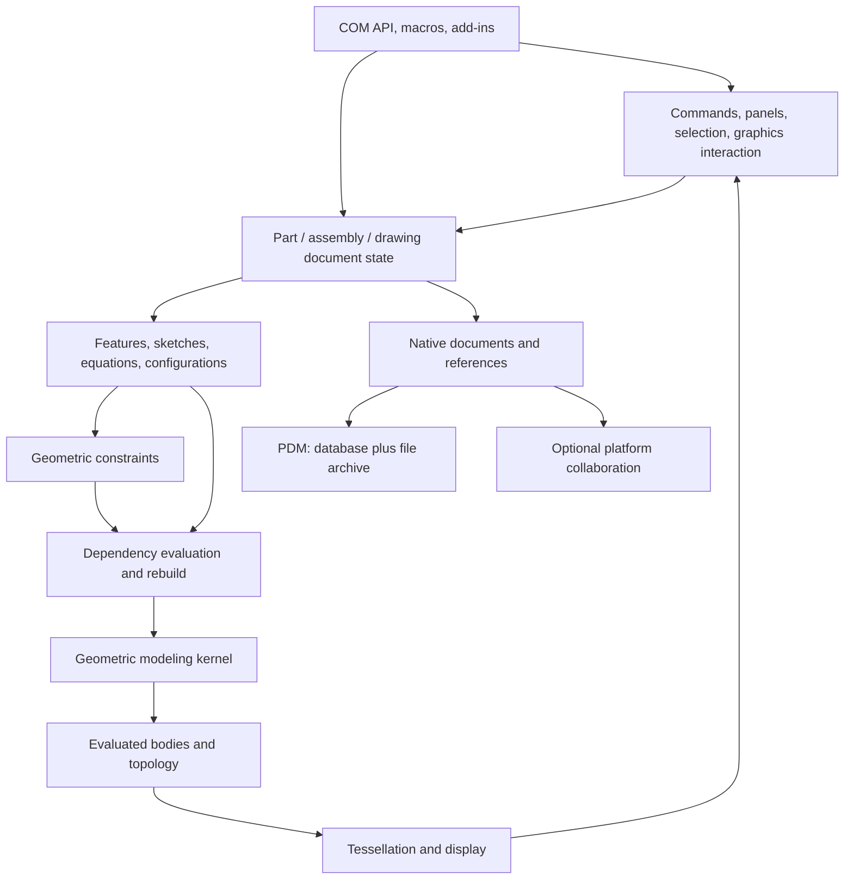

# SOLIDWORKS: a technical knowledge handbook

Prepared 19 October 2026. Scope: the desktop CAD application, its public object model, related engineering products, document storage, PDM, graphics, and the boundaries of the current investigation.

## How to read this document

This is an explanation assembled from trained knowledge, primary documentation, and the installer inspection performed in this workspace. It is not a recovered SOLIDWORKS source tree. Public API interfaces reveal contracts; they do not reveal the complete private implementation behind those contracts. Exact availability varies by release, edition, license, and installed add-ins.

Evidence labels used below:

- **Documented:** supported by linked vendor documentation.
- **Observed:** established by inspecting a particular local artifact.
- **General CAD explanation:** engineering principles that explain the problem; no claim that SOLIDWORKS uses precisely the illustrated algorithm or data structure.
- **Unknown:** requires examination of the actual CAD binaries, files, or a running installation.

The latest desktop executable has not been run or decompiled in this investigation. No SOLIDWORKS source code or private database is available to this assistant. A statement about a local installer does not establish a property of the CAD editor.

## 1. Identity, history, and scope

SOLIDWORKS is Dassault Systèmes' mechanical product-development software family. The company was founded in 1993, shipped SOLIDWORKS 95 in 1995, and was acquired by Dassault Systèmes in 1997. Later acquisitions helped expand simulation, data management, and technical communication capabilities. [Corporate history](https://www.solidworks.com/sw/docs/Corp_FactSheet_2012Q4.pdf)

The central CAD workflow creates individual parts, places part occurrences in assemblies, and generates engineering drawings. The wider portfolio includes simulation, manufacturing, electrical work, rendering, product data management, and cloud collaboration. Those capabilities span multiple products and integration boundaries. They should not be treated as one executable with one uniform backend or database. [Product overview](https://www.solidworks.com/product/solidworks-design)

## 2. The architectural model that explains the application

**General CAD explanation, informed by documented capabilities:** a useful decomposition is user interaction, document semantics, parametric evaluation, geometry, display, and persistence. These are responsibilities, not recovered private library names.



A software clone needs several interacting systems: a mesh viewer cannot replace the parametric document model; a geometric kernel alone does not supply the complete user workflow; and a relational database does not solve geometry. The diagram explains responsibilities without asserting which private processes or DLLs own them.

## 3. Documents: parts, assemblies, and drawings

**Documented:** the public API exposes the common document interface `IModelDoc2`, with document-specific interfaces `IPartDoc`, `IAssemblyDoc`, and `IDrawingDoc`. Common operations include saving and obtaining document information. Specialized operations belong to the relevant document type. These are COM interfaces rather than proof of a private C++ inheritance hierarchy. [Document API](https://help.solidworks.com/2022/english/api/sldworksapi/SolidWorks.Interop.sldworks~SolidWorks.Interop.sldworks.IModelDoc2.html)

Conceptually, a part contains design definitions and evaluated geometry. An assembly describes occurrences of parts and subassemblies, their positioning, and relationships. A drawing describes sheets, views, annotations, and documentation derived from model data. An assembly occurrence can carry state that is absent from the underlying part document.

Common file extensions are:

| Purpose | Extension |
|---|---|
| Part | `.sldprt` |
| Assembly | `.sldasm` |
| Drawing | `.slddrw` |
| Part / assembly / drawing templates | `.prtdot`, `.asmdot`, `.drwdot` |
| eDrawings exchange documents | `.eprt`, `.easm`, `.edrw` |

These are product document categories, not a specification of their byte layouts. [File categories](https://help.solidworks.com/2022/english/eDrawings/t_Opening_Files.htm?id=2.0.2.1)

## 4. Design intent and parametric modeling

**General CAD explanation:** an editable model preserves the reasons for a shape, not just its final boundary. A plate can be described by a rectangle, width and height dimensions, an extrusion depth, and a hole position related to its edges. Changing width then causes dependent results to update.

Two solids that look identical can have very different design intent. One might be an imported body; another might contain an editable sketch, extrusion, patterned holes, and fillets. Matching the final boundary is therefore a weaker form of compatibility than reproducing feature definitions, references, and rebuild behavior.

Design intent can include symmetry, equal sizes, concentricity, alignment, manufacturing clearances, standardized hole definitions, and links to other components. Robust intent uses relationships that survive expected changes. Fragile intent relies on incidental face order, unexplained offsets, or unstable external references.

## 5. Sketches and constraints

Sketch entities include points, lines, arcs, circles, splines, and construction geometry. Relations express coincidence, horizontal or vertical alignment, tangency, perpendicularity, parallelism, equal sizes, symmetry, and other conditions. Dimensions can control geometry or report an already-determined quantity.

**Documented:** Fully Define Sketch calculates additional dimensions and relations for underdefined geometry. Existing constraints and dimensions matter to that calculation. [Fully defined sketches](https://help.solidworks.com/2026/english/SolidWorks/sldworks/c_Fully_Defined_Sketches.htm)

**General CAD explanation:** collect geometric unknowns into a vector `x` and encode relations as equations `f(x)=0`. A circle has center and radius variables; a free 2D point has two coordinates. A constraint solver seeks a consistent solution while supporting dragging and reasonable continuity of motion. A sketch can be underconstrained, fully constrained, overconstrained, redundant, inconsistent, or geometrically degenerate. Counting constraints alone does not reliably distinguish these states because constraints can be dependent or become singular.

Illustrative equations:

```text
Coincident points: x1-x2 = 0, y1-y2 = 0
Horizontal line:   y1-y2 = 0
Fixed distance:    (x1-x2)^2 + (y1-y2)^2 - d^2 = 0
Perpendicular:     direction1 dot direction2 = 0
```

Numerical methods may use Jacobians, decomposition, and iterative correction. This is an explanation of the solver problem, not recovered SOLIDWORKS solver code. Siemens has historically documented SOLIDWORKS among applications using D-Cubed technology; the exact components, versions, and call paths in the current build remain unverified. [Historical vendor evidence](https://www.plm.automation.siemens.com/ko_kr/Images/plm_news_apr07_19_tcm72-26322.pdf)

## 6. Features and their definitions

Common feature families include extrusions, cuts, revolutions, sweeps, lofts, boundaries, holes, fillets, chamfers, shells, drafts, patterns, mirrors, reference geometry, surfaces, and direct edits. Their input contracts differ. A sweep needs a section and path; a loft needs sections and potentially guide geometry; a shell needs a body, thickness, and possibly removed faces.

**Documented API pattern:** `IFeature::GetDefinition` accesses typed feature data. Many feature-data interfaces require selection access while editing, followed by `ModifyDefinition` or release of selection access. The exact lifecycle is interface-specific. [An example feature contract](https://help.solidworks.com/2025/english/api/sldworksapi/SolidWorks.Interop.sldworks~SolidWorks.Interop.sldworks.ILibraryFormToolFeatureData.html)

**General CAD explanation:** a feature combines parameters, selected inputs, semantic options, and a procedure that evaluates a geometric result. Its preview and committed result may have different lifetimes. A well-designed implementation validates inputs, contains partial results, and reports failure without corrupting prior document state. Those are engineering requirements; the private SOLIDWORKS transaction implementation is unknown.

## 7. Feature order, dependencies, and rebuilds

**Documented:** model feature traversal order is different from the displayed FeatureManager order. Feature names and positions can change. API code should inspect feature types rather than assume fixed names or ordering. [Feature traversal](https://help.solidworks.com/2024/english/api/sldworksapi/solidworks.interop.sldworks~solidworks.interop.sldworks.ifeature~getnextfeature.html)

**General CAD explanation:** a history tree is a presentation of a richer dependency structure. A hole can depend on a sketch plane, sketch dimensions, and a body to cut. A fillet can depend on an edge produced by several earlier features. Changing a parent may invalidate descendants. Rebuilding therefore includes dependency resolution, feature evaluation, result validation, and display updates.

SOLIDWORKS distinguishes rebuilding items that require it from forcing a broader rebuild. The public example demonstrates `EditRebuild3` and `ForceRebuild3`; exact scope and configuration behavior must be read from the selected method's versioned documentation. [Rebuild example](https://help.solidworks.com/2019/English/api/sldworksapi/Rebuild_Example_VB.htm)

Rollback, suppression, freezing, hiding, and lightweight loading have different meanings. Rollback changes the evaluated history position; suppression removes participation in a configuration's evaluation; hiding affects visibility; freezing limits rebuild participation; lightweight loading limits resident model data. They cannot safely be represented by one generic visibility Boolean.

## 8. Geometry and the modeling kernel

**Documented:** SOLIDWORKS uses Siemens Parasolid geometric modeling technology. That identifies an important component, not the whole application. [Vendor evidence](https://blogs.sw.siemens.com/wp-content/uploads/sites/10/2023/05/CIMdata_Whitepaper_Siemens_PLM_Components.pdf)

**General CAD explanation:** boundary representation separates geometric descriptions from topological connectivity. A surface can be an infinite plane or cylinder; a face is a bounded, oriented use of a surface. Curves support edges; vertices connect edge endpoints; loops bound faces; connected faces form shells and bodies. Seam edges, periodic surfaces, holes, multiple loops, and orientations make the structure more complicated than a list of polygons.

Analytic geometry includes lines, circles, planes, cylinders, cones, spheres, and tori. Freeform geometry commonly uses spline representations. Parametric curve and surface evaluation supplies points, derivatives, tangents, normals, and curvature. Topology supplies adjacency and inside/outside meaning.

These distinctions explain why a cylinder drawn with many triangles can remain one analytic cylindrical face for measurement and editing, and why two geometrically coincident surfaces need not already form a watertight solid.

## 9. Boolean and surface operations

**General CAD explanation:** a Boolean union, intersection, or difference typically needs intersection discovery, curve/surface intersection, trimming, classification, topology reconstruction, orientation handling, and validation. A feature operation can also require sewing, offsetting, extending, blending, or repairing surfaces.

Numerical tolerances are unavoidable. Floating-point arithmetic does not establish exact coincidence by itself. Very short edges, sliver faces, tangent contacts, self-intersections, nearly coincident boundaries, and zero-thickness regions can make an operation fail or require special treatment.

A fillet is especially demanding: an apparently simple radius can encounter changing local curvature, tiny edges, competing blends, concave and convex corners, and self-intersection. Creating a visually rounded mesh is substantially easier than creating a valid editable solid with useful analytic properties.

Exact SOLIDWORKS tolerances, fallback heuristics, algorithms, and feature-to-kernel dispatch are unknown here. API-visible success or failure is evidence about a particular operation; it does not uniquely identify the algorithm used internally.

## 10. Topological identity and persistent references

**Documented:** persistent reference IDs identify selectable objects across sessions and can be resolved through `GetPersistReference3` and `GetObjectByPersistReference3`. This does not promise that a destroyed object survives an arbitrary redesign. [Persistent references](https://help.solidworks.com/2026/english/api/sldworksapiprogguide/Overview/Persistent_Reference_IDs.htm)

Tracking IDs have different semantics: the API documents propagation across certain modeling operations, including a face splitting into multiple faces. They are not interchangeable with persistent references or ordinary attributes. [Tracking IDs](https://help.solidworks.com/2024/english/api/sldworksapiprogguide/Overview/Tracking_IDs.htm)

**General CAD explanation:** a downstream fillet may refer to an edge that later splits or disappears. The software must determine whether the intended reference still has a meaningful successor. Indexing into the current edge list cannot solve that reliably. Identity must distinguish object lifetime, geometric similarity, design meaning, and provenance through operations. This is one of the hardest parts of a dependable parametric modeler.

## 11. Equations, units, and configurations

**Documented:** unless an API says otherwise, SOLIDWORKS API numerical quantities use units such as meters, radians, kilograms, square meters, and cubic meters. Displaying a document in millimeters does not change that default API convention. [API units](https://help.solidworks.com/2024/english/api/sldworksapiprogguide/Overview/Units.htm)

Equations can relate dimensions and variables. The API exposes an equation manager and examples of delayed evaluation. [Equation example](https://help.solidworks.com/2023/english/api/sldworksapi/Add_Equation_And_Evaluate_All_Example_VBNET.htm)

Configurations can vary dimensions, feature suppression, component choices, materials, custom properties, and other supported values. Design tables provide an Excel-based way to control many such parameters. A display state serves a different purpose: presentation can change without creating a different geometric design variant. [Design tables](https://help.solidworks.com/2026/English/SolidWorks/Sldworks/c_Design_Table_Configurations.htm), [display versus suppression](https://help.solidworks.com/2025/english/SolidWorks/sldworks/c_Simplifying_Large_Assemblies_SWassy.htm)

**General CAD explanation:** dimensions, equation evaluation, configuration overrides, and external references can form multiple interacting dependency graphs. A cached value may be valid for one configuration and stale for another. A robust implementation needs explicit scope and invalidation rather than one unqualified value per parameter.

## 12. Assemblies, occurrences, and coordinate systems

**Documented:** `IComponent2` represents occurrence-level information that cannot be recovered simply by using the referenced `IModelDoc2`. `GetModelDoc2` may return null for suppressed, lightweight, or unloaded components. The document state returned also depends on whether the part is open and which configuration is active or saved. [Component versus document](https://help.solidworks.com/2024/english/api/sldworksapi/solidworks.interop.sldworks~solidworks.interop.sldworks.icomponent2~getmodeldoc2.html)

**General CAD explanation:** ten instances of the same bolt share a design definition while occupying ten positions. Each occurrence needs its own transform and context. For a local point `p`, a placement can be explained as `p_world = R p + t`. Nested subassemblies compose placements. API-specific transform storage conventions should not be assumed to match an arbitrary graphics library's matrix layout.

An assembly also carries reference configurations, visibility, suppression, mates, overrides, BOM participation, and sometimes in-context design dependencies. A face in a part's own coordinates and the corresponding face on one assembly occurrence are related but not interchangeable references.

## 13. Mates, motion, collision, and interference

An unconstrained rigid body has six rigid degrees of freedom: three translations and three rotations. Relations remove freedoms or constrain combinations of them. Coincident, concentric, distance, angle, tangent, and mechanism-oriented mate types have different effects. **Documented:** the motion help explains this through degrees of freedom and redundancy. [Degrees of freedom](https://help.solidworks.com/2021/english/SolidWorks/motionstudies/c_degrees_freedom_motion.htm)

**General CAD explanation:** assembly placement is a constraint problem. Consistent initial positions, alternate solutions, grounded components, redundant constraints, flexible subassemblies, and closed loops complicate evaluation. Moving parts under mate constraints is a different calculation from predicting forces and accelerations.

Collision concerns contact during motion. Interference concerns overlapping volume at a placement. Clearance concerns separation. Geometric validity concerns whether each body itself is valid. These questions share geometric information but need different queries and failure explanations. A motion study adds time, masses, inertia, forces, contacts, and solver choices beyond ordinary assembly positioning.

## 14. The UI as a working system

**Documented:** the manager pane hosts FeatureManager, PropertyManager, ConfigurationManager, DimXpertManager, and DisplayManager roles. The CommandManager provides tools, while the graphics area displays and selects geometry. [Manager pane](https://help.solidworks.com/2025/english/SolidWorks/sldworks/c_management_panel.htm)

Other familiar interactions include context menus, shortcut bars, mouse gestures, view orientation, selection filters, search, task panes, confirmation controls, and document-specific tool availability. Exact layouts and defaults vary with customization and release.

**General interaction model:** a modeling command has context and state. For example: idle → choose a sketch or face → set feature parameters → inspect preview → accept or cancel. Changing the active document, sketch edit mode, selection type, units, or configuration can change what the same button means or whether it is enabled.

The public command API supports groups and document-type tabs, with customization data associated with the registry. This establishes an extensibility contract, not the framework used to implement every built-in control. [Command groups](https://help.solidworks.com/2022/english/api/sldworksapi/solidworks.interop.sldworks~solidworks.interop.sldworks.icommandmanager~createcommandgroup2.html)

## 15. Selection, PropertyManagers, and previews

Selection is more than highlighting. The application distinguishes selectable entity kinds, occurrence context, selection order, and operation-specific input roles. **Documented:** selection marks can partition the selection list into role-specific subsets. [Selection lists](https://help.solidworks.com/2018/english/api/sldworksapi/Selection_Lists_VB.htm)

PropertyManager add-in examples expose callbacks for text changes, selection submission, preview, undo, redo, and page activation. These public hooks demonstrate an event-oriented extension surface. They do not establish the exact built-in command state machine. [PropertyManager example](https://help.solidworks.com/2020/english/api/sldworksapi/Add_.NET_Controls_to_SOLIDWORKS_Using_an_Add-in_Example_CSharp.htm)

**General CAD explanation:** picking can begin with displayed geometry but must resolve an editable model entity. An apparent line on screen might represent an edge, a silhouette, a sketch segment, a temporary preview, or an annotation. A dependable UI preserves those distinctions, validates the role of each selection, explains rejected inputs, and avoids committing a stale preview after parameters have changed.

## 16. Graphics, tessellation, and rendering

**Documented:** SOLIDWORKS display performance depends in part on tessellation triangles, curved faces, image-quality settings, and face-level appearances. Display triangles must be calculated, stored, and transferred to the graphics card. [Display performance](https://help.solidworks.com/2025/English/SolidWorks/Sldworks/HIDD_ASSYXPERT_DISPLAY_SPEED.htm)

**General CAD explanation:** precise geometric data and display data have different purposes. A graphics mesh approximates surfaces for efficient display; the kernel supports geometric evaluation and modeling. Camera transforms, clipping, selection highlighting, transparency, edge overlays, section views, and material appearance form additional display responsibilities.

This also explains stale-display cases: correct geometry can coexist with an old mesh, and a convincing display can coexist with stale or unavailable detailed model data. A clone must define which representation is authoritative for editing, measuring, exporting, and rendering. The current private renderer, graphics API mix, scene acceleration structures, cache layout, and GPU command strategy have not been recovered.

## 17. Drawings and manufacturing documentation

Drawings organize sheets and model views, with scales, orientations, dimensions, notes, symbols, tables, and references to parts or assemblies. Typical views include orthographic, projected, section, detail, auxiliary, and broken views. Manufacturing documentation also includes datums, geometric tolerances, surface finishes, weld symbols, hole callouts, balloons, BOMs, and revision information.

**General CAD explanation:** a drawing view is a structured projection with references and annotations, not simply a saved screenshot. Updating a model may require updating projected edges, hidden-line results, dimension attachment, and table data. A dimension can express design intent or documentation rather than merely pixel distance.

**Documented example of associativity:** sheet-metal bend notes can update when bend angle, direction, or radius changes. This demonstrates model-driven documentation without proving that every annotation updates identically. [Associative bend notes](https://help.solidworks.com/2024/english/SolidWorks/sldworks/c_Sheet_Metal_Bend_Line_Notes.htm)

## 18. Sheet metal, weldments, surfaces, and specialized modeling

Sheet-metal modeling includes thickness, bend radii, reliefs, flat patterns, forming tools, and manufacturing allowances. **Documented:** the K-factor model locates the neutral sheet relative to material thickness. Its bend allowance is `BA = pi * (R + K*T) * A / 180`, with `A` in degrees. That formula is one documented model, not a universal description of every forming process. [K-factor](https://help.solidworks.com/2026/english/solidworks/sldworks/c_K_Factor.htm)

**General product knowledge:** weldment workflows combine profiles, structural paths, trimming, bodies, and cut lists. Surfacing uses curves and sheets to construct or repair shapes, with tangent and curvature continuity as important design goals. Mold tools address splitting, parting, cavities, cores, and manufacturability. Routing coordinates paths, fittings, components, and domain-specific data.

These workflows reuse geometry and document infrastructure while adding their own feature semantics and libraries. Their exact algorithms, option coverage, and internal schemas are not implied by the generic feature system. Specialized commands require separate behavioral investigation.

## 19. Physical properties, materials, and validation

**General engineering explanation:** volume, surface area, center of mass, and moments of inertia derive from geometric integration and material assignments. Appearance is distinct from physical material. A model can look metallic without having a meaningful density or constitutive model.

For example, an ideal `20 mm × 10 mm × 5 mm` block has volume `1000 mm³ = 10^-6 m³`. If its density is `7850 kg/m³`, its mass is `0.00785 kg`, or `7.85 g`. This is an illustrative arithmetic check, not a measured SOLIDWORKS result.

Materials may supply density and properties needed by downstream simulation, while display materials supply visual characteristics. The API includes material database and XML schema discovery. [Material database example](https://help.solidworks.com/2026/english/api/sldworksapi/Get_Material_Database_and_XML_Schema_File_Names_Example_VB.htm)

Other checks include interference, clearances, geometry validity, draft, thickness, curvature, and manufacturing constraints. A successful kernel operation does not by itself prove that a design is manufacturable or mechanically safe.

## 20. Simulation and numerical analysis

**General engineering explanation:** finite-element analysis converts geometry into a discretized problem, assigns materials, loads, constraints, and contacts, solves a system, and interprets results. A linear static problem is often summarized as `K u = F`. Modal, thermal, nonlinear, buckling, fatigue, and transient problems introduce different assumptions and equations.

**Documented:** SOLIDWORKS Simulation exposes solver choices including direct-sparse and FFEPlus families. The cited page is version-specific; its numerical resource estimates should not be treated as universal guarantees. [Solver options](https://help.solidworks.com/2021/english/SolidWorks/cworks/IDC_HELP_PRESTATIC_OPTIONS.htm)

Mesh refinement, element formulation, boundary conditions, contact handling, material assumptions, singularities, and convergence matter to accuracy. A plausible colored stress plot does not establish a correct model. Constraint solving for a sketch, mate solving for placement, geometry evaluation, and finite-element solving are distinct computations.

Topology optimization is another workflow; SOLIDWORKS documentation describes a SIMP density-based method. Its result can require interpretation and rebuilding into a practical design. [SIMP method](https://help.solidworks.com/2026/english/SolidWorks/cworks/c_simp_method_topology.htm)

## 21. The rest of the product family

**General product knowledge; entitlements must be checked for the selected release:** SOLIDWORKS-related tools cover structural simulation, fluid/thermal analysis, plastics processing, motion, electrical design, CAM, photorealistic visualization, model-based definition, technical communication, inspection, costing, and sustainability. PDM and Manage address organizational data and processes. eDrawings supports review and sharing.

These products may share files, metadata, UI integration, or launch workflows without sharing one implementation. For example, photorealistic rendering asks about light transport and visual materials; CAM asks about machining features, tools, setups, toolpaths, and machine output; electrical design adds schematic and connection semantics. Knowing the desktop sketcher does not establish the private implementation of those products.

The breadth of the product family is one reason that “everything in SOLIDWORKS” cannot honestly be equated to a single feature checklist or decompiled executable. [Current portfolio context](https://www.solidworks.com/product/solidworks-design)

## 22. Local storage and the meaning of “database”

Ordinary desktop CAD work is organized around documents, referenced documents, templates, settings, and libraries. This must be distinguished from PDM's server database and from cloud-managed objects. This investigation has not identified one global relational schema that stores all SOLIDWORKS modeling state.

**General document explanation:** a native CAD document can preserve feature definitions, references, configurations, properties, and evaluated or cached results. That is a semantic description, not a verified inventory of streams in a particular file version. Save/reopen behavior, dirty flags, and regeneration policy require testing against actual sample files.

**Documented limit:** starting with SOLIDWORKS 2015, third-party data in SOLIDWORKS files cannot be externally read or written using standard compound-file/structured-storage techniques; the supported API paths should be used. This statement concerns third-party data and should not be generalized into a claim that every modern file is encrypted or that every internal stream is known. [Third-party storage](https://help.solidworks.com/2025/English/api/sldworksapiprogguide/Overview/Third-party_Data_in_SOLIDWORKS_Files.htm)

## 23. Templates, settings, libraries, and references

**Documented:** document templates can store document properties such as units and standards, as well as initial sketches, notes, and features. System Options should not be conflated with the document properties saved in a template. [Templates](https://help.solidworks.com/2025/english/SolidWorks/sldworks/t_creating_a_template.htm)

Toolbox has its own library and database files. The official administration guidance names `swbrowser.sldedb` and older `SWBrowser.mdb`, along with checkout and upgrade requirements when managed by PDM. The extension alone does not establish a current database engine or schema. [Toolbox guidance](https://help.solidworks.com/2026/english/Installation/install_guide/c_notes_about_config_toolbox.htm)

**General CAD explanation:** dependencies include referenced parts, subassemblies, drawings, external design links, profiles, materials, templates, and other libraries. Moving or renaming files without preserving references can damage a project. A reproducible investigation therefore needs a dependency manifest, configuration information, version information, and stable copies rather than one isolated part file.

## 24. PDM: the actual server database boundary

**Documented:** a PDM vault view connects to an archive server holding physical files and a vault database holding information about files, items, and activities. That separation is central to understanding its architecture. [Vault architecture](https://help.solidworks.com/2024/English/EnterprisePDM/Admin/c_file_vaults_overview.htm)

SOLIDWORKS' backup guidance describes SQL databases for vaults and `ConisioMasterDB`, plus the file archive and archive-server configuration. A database-only backup does not include the complete file payload and server configuration. [Backup architecture](https://blogs.solidworks.com/products/solidworks/backup-and-restore-pdm/)

**General PDM explanation:** check-in/check-out, versions, revisions, workflows, permissions, local cache, and file references must remain coherent across metadata and file storage. Version and revision are different concepts: a stored iteration and a controlled release label need not advance together. These domain concepts do not disclose raw SQL table layouts. No PDM installation, production database, or transaction trace has been inspected here.

## 25. Cloud collaboration and product boundaries

The desktop editor, SOLIDWORKS Connected, platform services, and browser-native design applications should be identified separately. A shared brand or login does not prove identical geometry engines, document schemas, or process topology.

**Documented:** the 3DEXPERIENCE Files on This PC task pane manages local cache information and synchronization with the platform. An incomplete cache status and a document's modeling rebuild status describe different lifecycles. [Local platform cache](https://help.solidworks.com/2026/english/SolidWorks/sldworks/r_sws-3DExp-files-taskpane.htm)

**General distributed-system explanation:** local modification, local save, upload, server acceptance, synchronization, reservation, revision, and release are separate transitions. Offline edits require a defined reconciliation policy. A clone should model these states explicitly instead of labeling every pending action simply “saved.” The platform's private service architecture and database deployment have not been established in this investigation.

## 26. Public APIs, macros, add-ins, and document management

**Documented:** the primary desktop API is COM-based, with interfaces, factory methods, and `QueryInterface` semantics. Supported client languages and interop layers are not a specification of the implementation language of the whole product. [COM object model](https://help.solidworks.com/2021/english/api/sldworksapiprogguide/GettingStarted/Understanding_the_SolidWorks_API_Class_Hierarchy.htm)

Representative public interfaces include:

| Responsibility | Examples |
|---|---|
| Application and documents | `ISldWorks`, `IModelDoc2`, `IModelDocExtension` |
| Document specializations | `IPartDoc`, `IAssemblyDoc`, `IDrawingDoc` |
| Features and sketches | `IFeature`, `IFeatureManager`, `ISketch`, `ISketchManager` |
| Geometry and topology | `IBody2`, `IFace2`, `IEdge`, `ILoop2`, `IVertex`, `ISurface`, `ICurve` |
| Selection and presentation | `ISelectionMgr`, `ICommandManager`, PropertyManager interfaces |
| Assemblies and variants | `IComponent2`, `IConfiguration`, `IConfigurationManager` |

These interface families establish an accessible functional map, not complete private module boundaries. [API categories](https://help.solidworks.com/2024/english/api/sldworksapi/FunctionalCategories-sldworksapi.html)

Add-ins implement a loading lifecycle through `ISwAddin`, including `ConnectToSW` and `DisconnectFromSW`. Initialization can register UI and event handling. [Add-in lifecycle](https://help.solidworks.com/2019/English/api/swpublishedapi/SOLIDWORKS.Interop.swpublished~SOLIDWORKS.Interop.swpublished.ISwAddin~ConnectToSW.html)

Document Manager is a separate API for supported file/document access. It can be installed without the full editor but requires its own key and supporting runtime components. Available data access is not equivalent to a full parametric editing and regeneration engine. [Document Manager](https://help.solidworks.com/2025/english/api/swdocmgrapi/GettingStarted-swdocmgrapi.html)

## 27. API correctness and lifecycle hazards

**General automation guidance informed by documented contracts:** code must track active document, actual edit target, referenced configuration, selection roles, object validity, return values, and error codes. The active assembly can differ from the component currently being edited. A feature name is user-editable and therefore a weak primary identifier.

A managed wrapper does not guarantee that the underlying model entity survives a rebuild or document close. Event handlers and object references need deliberate ownership and cleanup. Calls that depend on current selection or UI state require more context than pure mathematical functions.

No claim of unrestricted thread-safe parallel mutation is supported by the evidence here. Conversely, it would be wrong to conclude that every SOLIDWORKS operation is single-threaded. Document regeneration dependencies, API call marshaling, rendering, and simulation can have different concurrency limits. Threading must be established for the specific interface and measured workload.

## 28. Interoperability and feature-history loss

SOLIDWORKS works with neutral and proprietary exchange formats through version-dependent translators. STEP, IGES, Parasolid, STL, DXF/DWG, and other formats carry different kinds of information. **Documented:** 3D Interconnect supports links to third-party CAD data and update workflows; its versioned format table should be consulted for actual compatibility. [3D Interconnect](https://help.solidworks.com/2023/english/SolidWorks/sldworks/c_sw_3d_interconnect.htm)

**General CAD explanation:** importing a shape is different from importing design history. A neutral solid can preserve useful geometry while losing the original sketches, feature definitions, relations, and configuration logic. A triangle mesh may preserve visible shape while losing analytic surfaces. Feature recognition can infer a new interpretation of geometry, but that does not prove recovery of the original design sequence.

Likewise, reading a newer native format, writing an older format, and reproducing modeling behavior across kernel versions are separate compatibility questions. They require explicit fixture files and versioned expectations.

## 29. Performance, memory, and recovery

**Documented:** lightweight components load a subset of model data and resolve more data as required. This is a semantic loading state, not merely a smaller display mesh or a hidden component. [Lightweight loading](https://help.solidworks.com/2020/english/SolidWorks/sldworks/c_Lightweight_Components_SWassy.htm)

**General performance explanation:** time can be spent loading references, parsing documents, solving constraints, regenerating features, tessellating geometry, updating drawings, saving, or waiting on PDM and cloud access. Memory can be consumed by precise geometry, feature state, resident configurations, mesh data, images, undo state, add-ins, and simulation problems. These are candidate cost centers, not measurements of the current executable.

Large design review, simplification, suppression, SpeedPak, and display settings serve different trade-offs. Optimizing one stage may not help a different bottleneck. Useful measurement separates open time, rebuild time, redraw time, save time, peak memory, and dependency/network delays.

Recovery also needs careful interpretation. Undo, autosave/recovery files, ordinary backups, version control, and PDM history protect against different failures. The private undo representation, recovery journal, save atomicity, and crash-recovery behavior remain unverified.

## 30. Installation, licensing, and platform support

The official requirements list Windows client systems, x86_64 processors, memory and graphics requirements, and specific supported virtualization products. Compatibility on Apple silicon through Windows application emulation must not be confused with a verified supported x86_64 installation. Requirements and support dates change by product release. [System requirements](https://www.solidworks.com/support/system-requirements)

Installation Manager selects and installs product components and prerequisites. Licensing can involve standalone activation, network licensing, or platform entitlements depending on the product and purchase. This handbook does not infer activation behavior from imported libraries or embedded URLs.

An official browser-based trial can supply a live UI without a local Windows installation, but a trial session does not automatically provide unrestricted filesystem or debugger access. [Official trial](https://www.solidworks.com/online-product-trials)

## 31. What the actual installer inspection established

**Observed:** `/Users/binova/Downloads/SolidWorksSetup.exe` is a 218,671,192-byte PE32 Windows executable containing a ZIP payload. The SHA-256 is `9d28ed0b923485340f67a4f308bb449624afe4cd23c80cd7c9726f910363221e`.

The archive inventory has 162 entries and no `SLDWORKS.exe`. It includes `setup.exe`, `sldim/sldIM.exe`, related installation utilities, localized resources, and a WebView2 runtime installer. The extracted XML identifies `SOLIDWORKS 2026 SP04.1`, build `34.4.1.1011`, and `SerialNumberRequired` equal to `1`.

The installer JavaScript contains `window.chrome.webview.postMessage(...)` calls. The installation-manager executable imports `WebView2Loader.dll`, `msi.dll`, Windows UI libraries, and other dependencies. These observations establish a native installation host with web-rendered UI integration; they do not establish the desktop CAD editor's UI framework. Vendor release notes independently document the Installation Manager's move to WebView2. [Installation Manager rendering](https://help.solidworks.com/2024/english/WhatsNew/c_wn2024_install_render_sldim.htm)

Reproduction:

```sh
python3 research/scripts/inspect_installer.py "/Users/binova/Downloads/SolidWorksSetup.exe" research/local-evidence
```

The script reads headers, imports, and archive contents without running the target. Selected extracted members pass ZIP CRC verification. The original artifact remains unchanged. The inventory is `research/local-evidence/installer_inventory.json`; the normalized JavaScript is `research/local-evidence/imfuncs.decoded.js`.

## 32. REA's role and its limits

REA is an investigation interface around analysis tools and evidence-producing workflows. Its native tooling can expose instructions, pseudocode, strings, symbols, and references when the selected engine and target are supported. It does not restore a complete original source tree or automatically explain all behavior of a large CAD application. [REA](https://github.com/morluto/rea), [native investigation](https://github.com/morluto/rea/blob/main/docs/native-investigation.md)

The local REA checkout inspected earlier identified commit `1991542e59f64d46269b3ff942be77a5ff06e88f` and package metadata version `6.4.0`. Those values identify that checkout, not a statement about today's latest npm release. No REA analysis of the actual `SLDWORKS.exe` has been performed.

Static disassembly can map particular functions and resources. Runtime experiments can test behavior and sequencing. Public API experiments can expose document and geometry state. Agreement across these evidence types supports a stronger conclusion than an isolated decompiler guess.

## 33. What remains unknown

The investigation has not established the complete private source-language mix, UI framework mix, process graph, DLL ownership map, solver implementation, kernel integration version, internal data structures, native-file byte schemas, compression layout, SQL table schemas, renderer internals, undo representation, thread-safety contracts, synchronization protocol, or complete architecture of every related product.

It also has not reproduced a CAD command inside a running SolidWorks session, examined an actual native CAD document, benchmarked modeling performance, or verified a SolidWorks installation on this Mac. Known product behavior and plausible implementation explanations must not be relabeled as observations of those internals.

## 34. A concrete path from knowledge to verified behavior

The next useful evidence set is a version-identified installed CAD executable and DLL inventory, plus a small controlled set of native documents and access to a running session. A basic fixture should contain a constrained sketch, extrusion, hole, fillet, a second configuration, two assembly occurrences, a mate, and a drawing.

For each operation, record inputs, selection roles, document/configuration state, result/error codes, topology counts, mass properties, saved-file hashes, reopen behavior, and relevant UI state. Vary one factor at a time: rename a feature, alter a parent dimension, suppress an input, change a configuration, replace a reference, or split a selected face.

The important cases include failure and recovery: cancel a preview, force an invalid fillet, resolve a lightweight component, close a document referenced by an add-in, move a dependency, or reopen a stale drawing. A trustworthy architectural explanation should predict those outcomes and then be checked against them.

This handbook provides a broad domain model and an evidence trail. It leaves private details explicitly unresolved until the required artifacts or experiments are available.
